  

    

  

    

  &nbsp;&nbsp;&nbsp;&nbsp;

    

  

 

Sou desenvolvedor Front-End e atuo na criação e evolução de aplicações web, transformando necessidades em interfaces funcionais, organizadas e intuitivas.

Tenho experiência com desenvolvimento e manutenção de aplicações, implementação de funcionalidades, construção de componentes reutilizáveis, operações CRUD e correção de problemas.

Gosto de explorar novas tecnologias, aprimorar minhas habilidades e buscar soluções que unam qualidade de código, usabilidade e uma boa experiência para o usuário.

Atualmente, meu foco está no ecossistema JavaScript e TypeScript, especialmente no desenvolvimento de aplicações com React.

 

  

    

  

    

  

    

  

 

> **Front-End Developer** &nbsp;·&nbsp; Hub Tecnológico
>
> - Desenvolvimento e manutenção de aplicações web.
> - Implementação de novas funcionalidades e melhorias.
> - Construção de componentes reutilizáveis e interfaces.
> - Desenvolvimento de operações CRUD.
> - Correção de bugs e aprimoramento de funcionalidades existentes.

> **Trainee Developer** &nbsp;·&nbsp; Data Smart
>
> - Análise de conjuntos de dados fornecidos por empresas clientes.
> - Criação de gráficos e visualizações utilizando Power BI.

> **Suporte Técnico** &nbsp;·&nbsp; Light System Software
>
> - Atendimento e suporte técnico por chat e telefone.
> - Auxílio na utilização de sistemas empresariais.
> - Identificação e resolução de problemas.
> - Suporte em rotinas fiscais e emissão de notas fiscais.

 

  

 

  

   

  

 

  

 

  **Vamos conversar sobre tecnologia e desenvolvimento.**

   

  &nbsp;&nbsp;

     

  Construindo, aprendendo e evoluindo continuamente.

   

  

